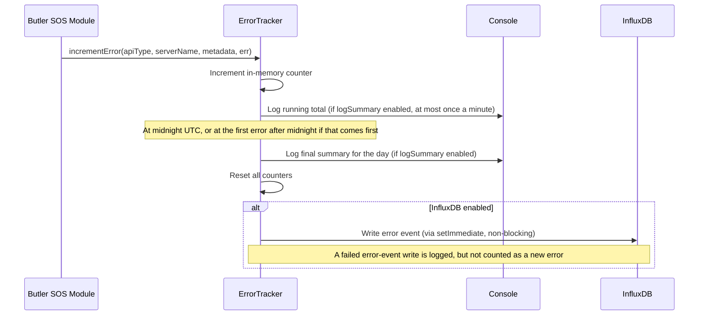

# Error Tracking

Butler SOS automatically monitors and records errors that occur when:

- Communicating with Qlik Sense servers (health checks, proxy sessions, app metadata)
- Writing metrics to destination systems (InfluxDB, MQTT, New Relic)
- Processing incoming UDP events from Qlik Sense

Error tracking helps you identify communication failures, misconfigurations, and connectivity issues across your Qlik Sense environment.

## Master Switch

`Butler-SOS.errorTracking.enable: false` disables **all** error tracking — in-memory counting, summary logging, and InfluxDB writes are all skipped. When set to `true` (the default), individual feature flags (`logSummary.enable`, `influxdb.enable`) control each sub-feature independently.

## How It Works



1. **Error detection**: When Butler SOS fails to communicate with a Qlik Sense server or write data to a destination system, the error is captured automatically.

2. **In-memory tracking**: Errors are counted and grouped by error type and server name. While errors occur, the running totals are logged to the console at most once a minute (if `logSummary.enable` is true).

3. **Daily summary**: At midnight UTC the counters are reset. If `logSummary.enable` is true, Butler SOS first logs a final summary of all errors counted during the day.

4. **InfluxDB write (optional)**: If `errorTracking.influxdb.enable` is true, each error is written as a separate data point in InfluxDB. Each point includes tags identifying the error type, server, host, virtual proxy, destination host, and module, plus an `error_category` field that categorizes the error (e.g., timeout, connection refused, auth error). If an error event cannot be written, that failure is logged but not counted as a new error. See [InfluxDB write failures](#influxdb-write-failures) below.

## Configuration

```yaml
Butler-SOS:
  errorTracking:
    enable: true                          # Master switch — disables all tracking when false
    logSummary:
      enable: true                        # Log running error totals and a daily summary to console
    influxdb:
      enable: true                        # Write individual error events to InfluxDB
      measurementName: butler_sos_errors  # InfluxDB measurement name
```

| Parameter | Description |
|-----------|-------------|
| `enable` | Master switch for all error tracking. `true`/`false` |
| `logSummary.enable` | Log the running error totals to the console (at most once a minute while errors occur) and a final summary at midnight UTC. When `false`, no summary is logged. `true`/`false` |
| `influxdb.enable` | Write individual error events to InfluxDB. `true`/`false` |
| `influxdb.measurementName` | InfluxDB measurement name (default: `butler_sos_errors`) |

## Error Types

These error type codes appear as the `error_type` tag in InfluxDB and in console log messages.

| Error Type | Description |
|------------|-------------|
| `HEALTH_API` | Health check API failures |
| `PROXY_API` | Proxy session API failures |
| `APP_NAMES_EXTRACT` | App name extraction failures |
| `INFLUXDB_V1_WRITE` | InfluxDB v1 write failures |
| `INFLUXDB_V2_WRITE` | InfluxDB v2 write failures |
| `INFLUXDB_V3_WRITE` | InfluxDB v3 write failures |
| `MQTT_PUBLISH` | MQTT publish failures |
| `NEW_RELIC_POST` | New Relic API post failures |
| `UDP_USER_EVENT` | UDP user event processing failures |
| `UDP_LOG_EVENT` | UDP log event processing failures |

::: info InfluxDB write errors in 15.1.1 and later
From Butler SOS 15.1.1, `INFLUXDB_V1_WRITE`, `INFLUXDB_V2_WRITE` and `INFLUXDB_V3_WRITE` count failed writes of regular data only: health metrics, sessions, user and log events, queue metrics and so on. A failed write of an error event itself is logged, but not counted. See [InfluxDB write failures](#influxdb-write-failures).
:::

## Module Context Values

When viewing errors in InfluxDB or Grafana, the `module` tag identifies which part of Butler SOS generated the error. This helps you pinpoint which subsystem is experiencing issues.

| Module Value | Description |
|--------------|-------------|
| `HEALTH_METRICS` | Qlik Sense engine health data write |
| `PROXY_SESSIONS` | Qlik Sense proxy session data write |
| `LOG_EVENTS` | Log event data write |
| `USER_EVENTS` | User event data write |
| `EVENT_COUNTS` | Event count metrics write |
| `REJECTED_EVENT_COUNTS` | Rejected event count metrics write |
| `QUEUE_METRICS` | Queue metrics write |
| `BUTLER_MEMORY` | Butler SOS own memory usage write |
| `HEALTH_METRICS_MQTT` | MQTT publish for health metrics |
| `PROXY_SESSIONS_MQTT` | MQTT publish for proxy sessions |
| `USER_EVENTS_MQTT` | MQTT publish for user events |
| `LOG_EVENTS_MQTT` | MQTT publish for log events |
| `HEALTH_METRICS_NEW_RELIC` | New Relic post for health metrics |
| `PROXY_SESSIONS_NEW_RELIC` | New Relic post for proxy sessions |
| `UPTIME_NEW_RELIC` | New Relic post for Butler SOS uptime |
| `UDP_USER_EVENTS` | UDP handler for user events |
| `UDP_LOG_EVENTS` | UDP handler for log events |

## InfluxDB Data Model

Every error event written to InfluxDB produces one data point with a mix of **tags** (indexed, for filtering/grouping) and **fields** (values, for querying/alerting).

### Tags

| Tag | Always present | Value |
|-----|---------------|-------|
| `error_type` | Yes | One of the error type codes (e.g. `HEALTH_API`, `INFLUXDB_V3_WRITE`) |
| `server_name` | Yes | Configured Qlik Sense server name, or `''` if not applicable |
| `host` | When provided | Hostname/IP of the Qlik Sense server or MQTT broker |
| `virtual_proxy` | `PROXY_API`, `PROXY_SESSIONS_MQTT` only | Virtual proxy prefix (e.g. `/`, `/hdr`) |
| `destination_host` | Destination write errors | Target URL for InfluxDB, New Relic etc. |
| `module` | When provided | Butler SOS subsystem (see Module Context Values table) |

### Fields

| Field | Type | Always present | Description |
|-------|------|---------------|-------------|
| `error_count` | integer | Yes | Always `1` — one point per error event |
| `error_category` | string | Yes | Human-readable category (see Error Categorization below) |
| `error_code` | string | When present | OS/library error code (e.g. `ECONNREFUSED`, `ETIMEDOUT`) |
| `http_status` | integer | HTTP errors only | HTTP response status code (e.g. `401`, `503`) |
| `request_url` | string | Axios errors only | Sanitized request URL — scheme + host + path, **query string stripped** |
| `request_timeout_ms` | integer | Axios errors with timeout | Configured Axios timeout in milliseconds (e.g. `5000`) |
| `remote_address` | string | TCP connection errors | Remote IP that was dialled |
| `remote_port` | integer | TCP connection errors | Remote port that was dialled |
| `syscall` | string | TCP connection errors | OS syscall that failed (e.g. `connect`) |

> `request_url` has query parameters stripped to avoid leaking secrets (e.g. `Xrfkey` values) into InfluxDB.

### Example line protocol entries

```text
# ECONNREFUSED dialling Qlik Sense proxy
butler_sos_errors,error_type=PROXY_API,server_name=sense2,host=pro2-win2.lab.ptarmiganlabs.net,virtual_proxy=/ error_count=1i,error_category="connection_refused",error_code="ECONNREFUSED",request_url="https://pro2-win2.lab.ptarmiganlabs.net:4243/qps/session",request_timeout_ms=5000i,remote_address="192.168.100.110",remote_port=4243i,syscall="connect"

# Timeout calling Qlik Sense health API
butler_sos_errors,error_type=HEALTH_API,server_name=sense1,host=sense1.example.com error_count=1i,error_category="timeout",error_code="ECONNABORTED",request_url="https://sense1.example.com:4747/engine/healthcheck",request_timeout_ms=5000i

# HTTP 401 from New Relic
butler_sos_errors,error_type=NEW_RELIC_POST,server_name=,module=HEALTH_METRICS_NEW_RELIC,destination_host=https://metric-api.newrelic.com error_count=1i,error_category="auth_error",http_status=401i,error_code=""

# InfluxDB v3 write failure (non-network)
butler_sos_errors,error_type=INFLUXDB_V3_WRITE,server_name=sense1,module=HEALTH_METRICS error_count=1i,error_category="unknown",error_code=""

# UDP event processing failure
butler_sos_errors,error_type=UDP_USER_EVENT,server_name=,module=UDP_USER_EVENTS error_count=1i,error_category="unknown",error_code=""
```

## Error Categorization

The `error_category` field helps you quickly understand the nature of each error. Categories are automatically assigned based on the error details (HTTP status code, network error code, error message).

### Categories

| Category | Trigger condition |
|---|---|
| `timeout` | `err.code === 'ETIMEDOUT'` or `'ECONNABORTED'`, message contains `'timeout'`, or `err.name === 'RequestTimedOutError'` |
| `connection_refused` | `err.code === 'ECONNREFUSED'` |
| `host_not_found` | `err.code === 'ENOTFOUND'` |
| `connection_reset` | `err.code === 'ECONNRESET'` |
| `auth_error` | HTTP status 401 or 403 |
| `not_found` | HTTP status 404 |
| `rate_limited` | HTTP status 429 |
| `http_5xx` | HTTP status ≥ 500 |
| `http_4xx` | HTTP status 400–499 (other than 401, 403, 404, 429) |
| `certificate_error` | Error message contains `'cert'`, `'TLS'`, or `'SSL'` |
| `mqtt_error` | Error message contains `'mqtt'` |
| `new_relic_error` | Error message contains `'new relic'` |
| `unknown` | No `err` object passed, or none of the above matched |

::: info Why two error code fields?
Butler SOS captures error details at two levels. Axios wraps Node's net layer, so for a connection refused error the Axios-level `err.code` is `ECONNREFUSED`, while the raw TCP-level `err.cause` holds `remote_address`, `remote_port`, and `syscall`. Both are stored independently — the Axios-level code determines the `error_category`, while the TCP fields help pinpoint exactly which host and port were involved.
:::

## Console Logging

### Running summary (at most once a minute)

When `Butler-SOS.errorTracking.logSummary.enable: true` (the default), Butler SOS logs the day's running error totals at `info` level:

```
2026-05-03T16:10:09.420Z info: ERROR TRACKER: Error counts today (UTC): Total=3, Details={"PROXY_API":{"total":2,"servers":{"sense1":2}},"HEALTH_API":{"total":1,"servers":{"sense1":1}}}
```

The `Details` JSON is grouped by error type → `{ total, servers: { serverName: count } }`. For errors with no server context the key `_no_server_context` is used.

The running summary is written:

- **at once** for the first error after a quiet minute, so a new problem shows up in the log straight away
- **at most once a minute** while errors keep occurring. Errors that occur in between are counted, and the next summary line includes them. When errors stop, one last running summary is written once the minute is up, provided Butler SOS is still running then.

::: info Changed in 15.1.1
Before Butler SOS 15.1.1, the running summary was logged on every single error. During an outage that could mean many lines per second, each one longer than the last.
:::

::: tip Restarts
If Butler SOS stops or restarts less than a minute after the last running summary line (for example a service restart, `docker stop`, or an exit after a crash), the errors counted since that line do not appear in a summary line. The counts are kept in memory only, so a restart also starts them from zero. The warnings and errors logged when each failure happened are not affected.
:::

### Daily midnight reset

At midnight UTC the counters are reset. If `logSummary.enable` is true, the tracker first logs the day's final summary. It includes every error counted that day, including any that were still waiting for a running summary line:

```
ERROR TRACKER: Midnight UTC reached, resetting error counters
ERROR TRACKER: Error counts today (UTC): Total=47, Details={...}
ERROR TRACKER: Reset all error counters
ERROR TRACKER: Scheduled next error counter reset at 2026-05-04T00:00:00.000Z (in 1440 minutes)
```

The first error after midnight is logged at once, as the first error of the new day.

Midnight works the same way when Butler SOS is busy at that moment. If an error arrives in the first moments after midnight, before the midnight reset has run, that error ends the previous day itself: it logs the final summary and resets the counters, and is then counted as the new day's first error. When the midnight reset runs a moment later, it finds nothing left to do. Either way, each day's final summary is logged exactly once, and it contains only that day's errors.

::: info Changed in 15.1.1
Before Butler SOS 15.1.1, the midnight summary was logged even when `logSummary.enable` was `false`. Now `logSummary.enable` controls all summary lines. The counters are reset at midnight either way.
:::

### Debug-level messages

At `debug` log level, individual counter increments are also logged:

```
ERROR TRACKER: Adding first error count for PROXY_API/sense1
ERROR TRACKER: Incremented error count for PROXY_API/sense1, new count: 2
ERROR TRACKER: Date changed from 2026-05-03 to 2026-05-04, resetting counters
ERROR TRACKER: Error counters already reset for 2026-05-04, nothing to do   ← midnight reset ran after the new day's first error
ERROR TRACKER: InfluxDB write failed: <message>   ← only when an error event could not be written to InfluxDB
```

### InfluxDB write failures

Error events are written to InfluxDB asynchronously, so writing them never blocks the error tracking path.

Writing an error event can fail like any other InfluxDB write. This is most likely when InfluxDB is down or unreachable, or when it rejects the data, for example because of a permissions problem, a missing bucket or database, or a field type conflict in the error measurement.

From Butler SOS 15.1.1, such a failure is logged but **not** counted as a new error, and no new error event is written for it. Failures of regular data writes are counted, logged in the summary and written as error events, as before.

A failed error-event write is easy to recognise in the log: the message contains `Error event:`, followed by the error type and server name of the error that was being recorded. For example, an InfluxDB v2 server rejecting the error event for a failed health check:

```
warn: INFLUXDB V2 WRITE: Error event: HEALTH_API/sense1 (chunk 1/1, points 0-0) - Non-retryable error (HttpError), not retrying: ...
error: INFLUXDB V2 BATCH: Error event: HEALTH_API/sense1 - Chunk 1 of 1 (points 0-0) failed: ...
```

If InfluxDB cannot be reached at all, Butler SOS retries the write a few times before giving up:

```
warn: INFLUXDB V2 RETRY: Error event: HEALTH_API/sense1 (chunk 1/1, points 0-0) - Retryable error (Error) on attempt 1/4, retrying in 1000ms...
error: INFLUXDB V2 RETRY: Error event: HEALTH_API/sense1 (chunk 1/1, points 0-0) - All 4 attempts failed. Last error: connect ECONNREFUSED ...
```

A single failed error event can produce several such lines. That number is fixed; it does not grow over time.

As an extra safeguard, Butler SOS never starts a new error-event write from inside another one. If that safeguard is ever triggered, this is logged at `debug` level. The error is still counted, just not written to InfluxDB:

```
ERROR TRACKER: Not writing error event INFLUXDB_V2_WRITE/sense1 to InfluxDB, as it was raised while writing another error event
```

::: warning Versions before 15.1.1
Before 15.1.1, a failed error-event write was counted as a new InfluxDB write error. Counting it started another error-event write, which failed in the same way and was counted again, so the writes multiplied quickly. The log filled with `Error event:` warnings, CPU and memory use climbed, and the Butler SOS process could run out of memory. If you see this on an older version, upgrade to 15.1.1 or later, or set `errorTracking.influxdb.enable: false` until you can.
:::

If you see these messages, Butler SOS cannot store error events in InfluxDB. Check that:

- InfluxDB is running and reachable from the Butler SOS server
- the database (InfluxDB v1 and v3) or the organisation and bucket (InfluxDB v2) set in `Butler-SOS.influxdbConfig` exist
- the credentials Butler SOS uses are allowed to write to them

If you do not need error events in InfluxDB, set `Butler-SOS.errorTracking.influxdb.enable` to `false`.

## Grafana Usage Examples

### Rate of errors by type and module (InfluxDB v2 / Flux)

```text
from(bucket: "mybucket")
  |> range(start: -1h)
  |> filter(fn: (r) => r._measurement == "butler_sos_errors")
  |> filter(fn: (r) => r._field == "error_count")
  |> aggregateWindow(every: 5m, fn: sum, createEmpty: false)
  |> group(columns: ["error_type", "module"])
```

### Health check failures per server (InfluxDB v2 / Flux)

```text
from(bucket: "mybucket")
  |> range(start: -1h)
  |> filter(fn: (r) => r._measurement == "butler_sos_errors")
  |> filter(fn: (r) => r.error_type == "HEALTH_API")
  |> filter(fn: (r) => r._field == "error_count")
  |> aggregateWindow(every: 5m, fn: sum, createEmpty: false)
  |> group(columns: ["server_name"])
```

### Errors broken down by category (InfluxDB v2 / Flux)

```text
from(bucket: "mybucket")
  |> range(start: -24h)
  |> filter(fn: (r) => r._measurement == "butler_sos_errors")
  |> filter(fn: (r) => r._field == "error_count")
  |> group(columns: ["error_category"])
  |> sum()
```

### Remote addresses that caused connection errors (InfluxDB v2 / Flux)

```text
from(bucket: "mybucket")
  |> range(start: -24h)
  |> filter(fn: (r) => r._measurement == "butler_sos_errors")
  |> filter(fn: (r) => r._field == "remote_address")
  |> group(columns: ["server_name", "error_type"])
  |> last()
```

### Errors with request URL detail (InfluxDB v2 / Flux)

Useful for confirming which endpoint is being called when errors occur:

```text
from(bucket: "mybucket")
  |> range(start: -1h)
  |> filter(fn: (r) => r._measurement == "butler_sos_errors")
  |> filter(fn: (r) => r._field == "request_url")
  |> group(columns: ["error_type", "server_name"])
  |> last()
```

## Query Examples

### Total errors by type (InfluxQL / InfluxDB v1)

```sql
SELECT SUM("error_count") FROM "butler_sos_errors"
WHERE time > NOW() - 1h
GROUP BY "error_type", "server_name", "module" FILL(0)
```

### Connection error detail (InfluxQL / InfluxDB v1)

```sql
SELECT "remote_address", "remote_port", "request_url", "error_category"
FROM "butler_sos_errors"
WHERE "error_type" = 'PROXY_API' AND time > NOW() - 1h
ORDER BY time DESC
```

### InfluxDB v3 / SQL

```sql
SELECT error_type, server_name, error_category, error_code,
       remote_address, remote_port, request_url, request_timeout_ms
FROM butler_sos_errors
WHERE time > now() - interval '1 hour'
ORDER BY time DESC
```
